# Feature Spec 10: Incident Postmortems & Knowledge Base Memory

## 1. Overview & Objective
When incidents occur, organizations suffer from "institutional amnesia" where identical outages are diagnosed and solved from scratch repeatedly. The **Incident Postmortems & Knowledge Base Memory** subsystem enables the agent to:
1. Standardize and generate structured Root Cause Analysis (RCA) postmortem reports immediately upon resolving an incident.
2. Persist postmortems to disk under `.postmortems/`.
3. Search and reference past incident history during active triage to apply proven remediations rapidly.

## 2. Architecture & Workflow

```mermaid
flowchart TD
    subgraph Resolution_Phase ["Incident Resolution Phase"]
        Fix["Issue Resolved on Cluster"] --> PostmortemTool["generate_postmortem_report"]
        PostmortemTool --> Markdown["Format Standard RCA Markdown"]
        Markdown --> SaveDisk["Persist to .postmortems/incident-<id>.md"]
    end

    subgraph Triage_Phase ["Future Incident Triage Phase"]
        NewAlert["New Alert: 504 Gateway Timeout"] --> KBSearch["knowledge_base_search"]
        KBSearch --> QueryDisk["Scan .postmortems/ for Similar Keywords"]
        QueryDisk --> Match["Match: Database Connection Starvation"]
        Match --> ProvenFix["Apply Known Fix: Increase HikariCP Pool Size"]
    end
```


## 3. Data Interface & Schema
Located in [`src/tools/postmortem.ts`](file:///Users/joshua.williams/Documents/research/devops-agent/src/tools/postmortem.ts):
```typescript
export interface PostmortemData {
  incidentTitle: string;
  severity: 'SEV-1' | 'SEV-2' | 'SEV-3' | 'SEV-4';
  affectedServices: string[];
  symptom: string;
  rootCause: string;
  remediation: string;
  preventionItems: string[];
  startTime?: string;
  resolvedTime?: string;
}

export class PostmortemTool {
  static async generate(data: PostmortemData): Promise<string>;
  static async searchKnowledgeBase(query: string): Promise<string>;
  static async listReports(): Promise<Array<{ filename: string; title: string; date: string; size: number }>>;
  static async getReport(filename: string): Promise<string | null>;
}
```

## 4. Standard RCA Postmortem Format
Reports generated by the tool follow Google SRE best practices:
- **Header:** Incident Title, Severity Badge, Timestamp, Duration.
- **Executive Summary:** High-level summary of customer impact.
- **Affected Workloads:** Pods, namespaces, and services impacted.
- **Root Cause Analysis (RCA):** Deep technical explanation of the breakdown.
- **Remediation & Recovery:** Immediate fix steps taken.
- **Preventative Action Items:** Concrete backlog items to prevent recurrence.

## 5. Report Download & Knowledge Base UI
Operators can retrieve and download postmortem reports through multiple channels:
1. **Direct Disk Access:** Markdown files stored under `reports/postmortem-<date>-<slug>.md`.
2. **REST API Endpoints:**
   - `GET /api/reports`: Lists all generated reports with dates, titles, and sizes.
   - `GET /api/reports/download?file=<name>`: Streams the raw Markdown document with `Content-Disposition: attachment`.
3. **Mission Control Web Console (`/dashboard`):**
   - **Tab 6 (Incident RCA & Reports):** Features a dedicated "Generated Postmortem Incident Reports" card catalog with `👁️ View` (in-browser markdown rendering) and `📥 Download .md` (1-click browser download).
   - **Tab 1 (Interactive Terminal):** Features an `📥 Download` button in the terminal header to export any active triage or investigation output as a timestamped Markdown report.

## 6. Verification & Tests
Verified in [`test/smoke.test.ts`](file:///Users/joshuawilliams/Documents/Research/devops-agent/test/smoke.test.ts):
- Test 8: Verifies markdown postmortem generation with structured RCA sections.
- Test 9: Verifies that searching the knowledge base returns relevant past postmortems.
- Test 102: Verifies `PostmortemTool.listReports()` returns generated postmortem markdown reports with title, date, size, and filename.
- Test 103: Verifies `PostmortemTool.getReport()` returns markdown contents for valid reports, safely blocks directory traversal, and rejects non-markdown files.
- Test 104: Verifies Mission Control HTML includes 1-click terminal report download, audit export, and postmortem catalog.
