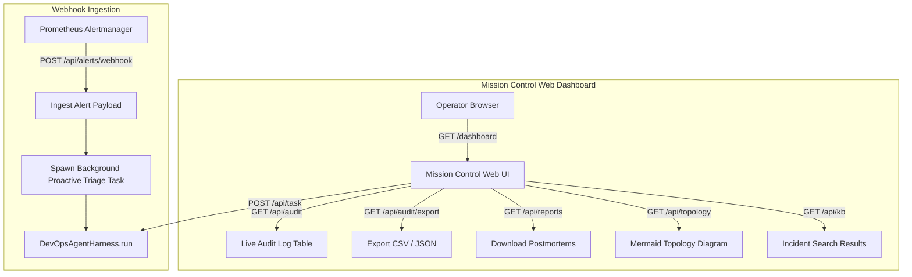

# Feature Spec 22: Mission Control Web Console & Alert Webhook Server

## 1. Overview & Objective
The **Mission Control Web Console & Alert Webhook Server** serves as the graphical management and observability interface for the Junior DevOps Agent. It provides:
1. A real-time, browser-based DevOps terminal emulator with Quick Action buttons.
2. Ingestion webhooks for Prometheus Alertmanager, Azure Monitor, and PagerDuty to launch autonomous incident triage.
3. Live visualization of audit logs, cluster topology, and historical RCA incident postmortems.

## 2. Server Architecture & Endpoints
Located in [`src/server/webhook.ts`](file:///Users/joshua.williams/Documents/research/devops-agent/src/server/webhook.ts) and [`src/server/dashboardHtml.ts`](file:///Users/joshua.williams/Documents/research/devops-agent/src/server/dashboardHtml.ts):

| HTTP Method | Route | Purpose | Output Format |
| :--- | :--- | :--- | :--- |
| **`GET`** | `/dashboard` | Mission Control Web Console UI | HTML5 / CSS3 / JavaScript |
| **`POST`** | `/api/alerts/webhook` | Ingests monitoring alerts and triggers proactive triage | JSON `{ status: 'accepted', target: ... }` |
| **`POST`** | `/api/task` | Executes interactive tasks and direct cluster diagnostics | JSON `{ result: string, error?: string }` |
| **`GET`** | `/api/audit` | Retrieves recent tamper-evident audit records | JSON `{ records: AuditRecord[] }` |
| **`GET`** | `/api/audit/export` | Exports full compliance audit trail (`?format=csv` or `?format=json`) | CSV (`devops-audit-*.csv`) / JSON attachment |
| **`GET`** | `/api/kb` | Searches historical postmortems (`?q=query`) | JSON `{ query: string, results: string }` |
| **`GET`** | `/api/reports` | Lists stored postmortem markdown incident reports | JSON `{ reports: Array<{ filename, title, date, size }> }` |
| **`GET`** | `/api/reports/download` | Downloads specific postmortem markdown report (`?file=...`) | Markdown attachment (`Content-Disposition: attachment`) |
| **`GET`** | `/api/topology` | Discovers cluster service dependency graph | JSON `{ topology: string }` |
| **`GET`** | `/health` | System healthcheck and uptime monitoring | JSON `{ status: 'ok', uptime: number }` |

## 3. UI Features
- **Interactive Terminal:** Dispatches natural language tasks or direct slash commands with live stream feedback and error visibility.
  - **📥 Download Button:** 1-click export of current terminal investigation output, container vulnerability scans, or diff analysis into a timestamped Markdown report (`devops-investigation-report-*.md`).
  - **📋 Copy Button:** Instant clipboard copy of the terminal stream.
- **Guardrail Policy & Audit Stream:**
  - **📥 Export JSON & 📥 Export CSV:** 1-click download of the complete tamper-evident audit trail (`devops-audit-*.csv` or `devops-audit-*.json`).
  - **Filter Chips:** Triage by safety tier (`READ`, `MUTATE`, `DANGEROUS`).
- **Incident RCA Knowledge Base & Reports:**
  - **Generated Postmortem Reports Catalog:** Visual cards showing all stored postmortems with title, date, and file size.
  - **👁️ View Button:** In-browser Markdown preview of past incidents and RCA findings.
  - **📥 Download .md Button:** 1-click download of the raw SRE postmortem Markdown report.
  - **Semantic / Keyword Runbook Search:** Full-text instant search across historical incidents.

## 4. Verification & Tests
Verified in [`test/smoke.test.ts`](file:///Users/joshuawilliams/Documents/Research/devops-agent/test/smoke.test.ts):
- Test 18: Validates Web Dashboard HTML generation, CSS dark-mode styling, and audit table layout.
- Test 102: Verifies `PostmortemTool.listReports()` returns generated postmortem markdown reports.
- Test 103: Verifies `PostmortemTool.getReport()` returns markdown contents for valid reports and blocks traversal.
- Test 104: Verifies Mission Control HTML includes 1-click terminal report download, audit export, and postmortem catalog.
