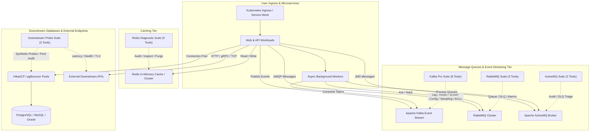

# Feature Spec 30: Enterprise Middleware, Message Queues & Downstream Services

## 1. Overview & Objective
Modern enterprise microservice architectures depend heavily on asynchronous message brokers, low-latency in-memory caches, and multi-tier downstream databases. When outages or degradations occur, root causes frequently manifest not within Kubernetes pod schedulers, but inside downstream middleware:
- **Cache Stampedes & OOM:** Redis memory fragmentation, single-threaded slowlog blocks (e.g. `KEYS *`), and aggressive key eviction.
- **Consumer Stalls & Lag Spikes:** Apache Kafka partition skew, consumer group rebalancing storms, and under-replicated partitions (URP).
- **Unacknowledged Backpressure & DLQs:** RabbitMQ memory/disk alarms, unacknowledged message backlogs, and dead-letter queue (DLQ) accumulation.
- **JMS Poison Pills & Store Exhaustion:** ActiveMQ broker persistence store saturation and unhandled poison-pill exceptions in `ActiveMQ.DLQ`.
- **Downstream Cascading Failures:** Database connection pool starvation (HikariCP / pgBouncer) and degraded synthetic endpoint latencies.

**Feature Spec 30** establishes a comprehensive suite of **21 specialized diagnostic and remediation tools**, progressive safety guardrails, and automated SRE runbooks to triage, inspect, and safely remediate middleware incidents.

---

## 2. Architecture & Topology

---

## 3. Tool Catalog & Capabilities (21 Native Tools)

### 3.1 Redis In-Memory Cache Suite (5 Tools)
Located in [`src/tools/middleware_cache.ts`](file:///Users/joshuawilliams/Documents/Research/devops-agent/src/tools/middleware_cache.ts):

| Tool Name | Guardrail Tier | Parameters | Purpose |
| :--- | :--- | :--- | :--- |
| **`redis_info_diagnose`** | `READ / Tier 1` | `host`, `port`, `namespace`, `podName`, `context` | Audits memory fragmentation ratio, connected/blocked client counts, hit/miss ratios, and memory peak usage. |
| **`redis_slowlog_inspect`** | `READ / Tier 1` | `host`, `port`, `namespace`, `podName`, `limit`, `context` | Inspects Redis slowlog to pinpoint blocking $O(N)$ operations (`KEYS *`, large `HGETALL`, heavy Lua scripts). |
| **`redis_key_analysis`** | `READ / Tier 1` | `host`, `port`, `pattern`, `namespace`, `context` | Samples keyspace via non-blocking `SCAN` to report namespace distribution, memory allocations, and TTL expiration status. |
| **`redis_cache_purge`** | `Tier 2 Approval` | `pattern` (required), `host`, `port`, `namespace`, `context` | Invalidates cached keys matching specific prefixes. **Safety guardrail:** permanently blocks root wildcard `"*"` purges in production. |
| **`redis_eviction_audit`** | `READ / Tier 1` | `host`, `port`, `namespace`, `context` | Audits `evicted_keys`, maxmemory policies (`volatile-lru`, `allkeys-lru`, `noeviction`), and flags cache stampede risks. |

### 3.2 Apache Kafka Event Streaming Suite (8 Tools)
Located in [`src/tools/middleware_kafka.ts`](file:///Users/joshuawilliams/Documents/Research/devops-agent/src/tools/middleware_kafka.ts):

| Tool Name | Guardrail Tier | Parameters | Purpose |
| :--- | :--- | :--- | :--- |
| **`kafka_consumer_lag`** | `READ / Tier 1` | `bootstrapServers`, `consumerGroup`, `topic`, `namespace`, `context` | Audits consumer group log-end-offsets, current consumer offsets, partition-level lag, and consumer stalling. |
| **`kafka_cluster_health`** | `READ / Tier 1` | `bootstrapServers`, `namespace`, `context` | Audits broker status, active controller identity, Under-Replicated Partitions (URP), and In-Sync Replicas (ISR). |
| **`kafka_topic_inspect`** | `READ / Tier 1` | `topic` (required), `bootstrapServers`, `namespace`, `context` | Evaluates partition count, replication factor, retention configuration, and leader partition balance. |
| **`kafka_offset_reset`** | `Tier 2 Approval` | `consumerGroup`, `topic`, `resetTo`, `value`, `dryRun`, `bootstrapServers`, `namespace`, `context` | Repositions consumer group offsets (`earliest`, `latest`, `shift-by`, `to-datetime`). Mandatory dry-run verification before commit. |
| **`kafka_broker_config`** | `READ / Tier 1` | `bootstrapServers`, `brokerId`, `namespace`, `podName`, `context` | Audits static & dynamic broker properties, `advertised.listeners` routability, thresholds (`min.insync.replicas`), JVM heap, and disk capacity with credentials masking. |
| **`kafka_message_sample`** | `READ / Tier 1 (Financial Safe)` | `topic` (required), `partition`, `offset`, `maxMessages`, `metadataOnly`, `bootstrapServers`, `namespace`, `context` | Financial-grade non-destructive message inspection. Zero offset commits (`enable.auto.commit=false`). Headers-only by default (`metadataOnly: true`), with PCI-DSS/PII data masking when payloads are previewed. |
| **`kafka_topic_manage`** | `Tier 2 Approval` | `topic` (required), `action` (required), `partitions`, `configKey`, `configValue`, `dryRun`, `bootstrapServers`, `namespace`, `context` | Topic scaling and management: expand partition count, alter dynamic configurations (`retention.ms`), or trigger preferred replica leader election. Wildcard mutations blocked. |
| **`kafka_security_audit`** | `READ / Tier 1` | `bootstrapServers`, `namespace`, `podName`, `context` | Audits cluster security: broker TLS certificate expiration windows, SASL authentication mechanisms (`SCRAM-SHA-512`, `OAUTHBEARER`), and Access Control Lists (ACLs). |

### 3.3 RabbitMQ & Apache ActiveMQ Queue Suites (5 Tools)
Located in [`src/tools/middleware_queues.ts`](file:///Users/joshuawilliams/Documents/Research/devops-agent/src/tools/middleware_queues.ts):

| Tool Name | Guardrail Tier | Parameters | Purpose |
| :--- | :--- | :--- | :--- |
| **`rabbitmq_queue_status`** | `READ / Tier 1` | `managementUrl`, `vhost`, `queueName`, `namespace`, `context` | Audits queue message depths, ready messages, unacknowledged backpressure, consumer counts, and ingest rates. |
| **`rabbitmq_dlq_inspect`** | `READ / Tier 1` | `dlqName` (required), `managementUrl`, `vhost`, `namespace`, `context` | Inspects Dead-Letter Exchanges (DLX) and Dead-Letter Queues (DLQ), sampling rejection causes and failed payloads. |
| **`rabbitmq_alarms_check`** | `READ / Tier 1` | `managementUrl`, `namespace`, `context` | Detects cluster-wide node alarms, memory high watermark breaches, disk free space limits, and blocked publishers. |
| **`activemq_queue_audit`** | `READ / Tier 1` | `brokerUrl`, `queueName`, `namespace`, `context` | Audits ActiveMQ broker queues, pending JMS messages, consumer count, and persistence store utilization. |
| **`activemq_dlq_triage`** | `READ / Tier 1` | `dlqName`, `brokerUrl`, `namespace`, `context` | Triages `ActiveMQ.DLQ`, extracting poison pill messages, socket timeouts, and Java exception stack traces. |

### 3.4 Downstream Synthetic Probing & Database Pool Suite (3 Tools)
Located in [`src/tools/downstream_services.ts`](file:///Users/joshuawilliams/Documents/Research/devops-agent/src/tools/downstream_services.ts):

| Tool Name | Guardrail Tier | Parameters | Purpose |
| :--- | :--- | :--- | :--- |
| **`service_endpoint_probe`** | `READ / Tier 1` | `targetUrl` (required), `method`, `timeoutMs`, `namespace`, `context` | In-cluster synthetic probe measuring HTTP/HTTPS status, TCP socket latency, DNS resolution, and TLS handshake health. |
| **`db_pool_audit`** | `READ / Tier 1` | `serviceName`, `namespace`, `context` | Audits downstream database connection pools (HikariCP, pgBouncer), detecting thread starvation and connection leaks. |
| **`downstream_dependency_map`** | `READ / Tier 1` | `namespace`, `context` | Synthesizes an end-to-end downstream dependency map linking workloads to databases, Redis, Kafka, RabbitMQ, and APIs. |

---

## 4. Automated SRE Runbooks

Integrated within [`src/tools/runbook.ts`](file:///Users/joshuawilliams/Documents/Research/devops-agent/src/tools/runbook.ts), the engine includes step-by-step automated runbooks for incident resolution:

1. **`kafka-consumer-lag-remediation`**:
   - `inspect_consumer_lag`: Pinpoint lagging partitions and consumer IDs.
   - `inspect_worker_pod_logs`: Analyze consumer thread health and JVM GC pauses.
   - `scale_consumer_replicas`: Horizontally autoscale consumer worker pods up to partition count limit.
   - `verify_lag_drain`: Monitor lag reduction until nominal threshold (< 100 messages) is achieved.

2. **`redis-oom-cache-stampede`**:
   - `audit_memory_and_evictions`: Check memory fragmentation and eviction velocity.
   - `check_slowlog_blocking_keys`: Identify expensive blocking queries.
   - `adjust_maxmemory_policy`: Adjust `maxmemory-policy` to `allkeys-lru` or expand Redis memory limit.
   - `verify_cache_hit_rate`: Confirm stabilization of cache hit ratio (> 85%).

3. **`redis-failover-reconcile`**:
   - `check_sentinel_quorum`: Check Redis Sentinel quorum and replica synchronization status.
   - `trigger_sentinel_failover`: Initiate controlled failover to promote healthy replica.
   - `verify_read_write_health`: Verify write operations on new primary and replica replication stream.

4. **`rabbitmq-unacked-queue-backpressure`**:
   - `audit_queue_metrics`: Measure unacknowledged vs ready message backlog.
   - `scale_worker_pool`: Scale AMQP consumer deployment to drain queue backlog.
   - `verify_queue_drain`: Verify unacked message count decreases to normal operational levels.

5. **`activemq-dlq-surge`**:
   - `inspect_dlq_depth`: Assess total message accumulation in `ActiveMQ.DLQ`.
   - `sample_poison_pill_headers`: Sample message headers for `dlqDeliveryFailureCause` and schema mismatches.
   - `verify_dlq_stabilization`: Quarantine poison pills to unblock subsequent transactional queues.

6. **`downstream-service-circuit-breaker-open`**:
   - `probe_downstream_endpoint`: Synthetically probe downstream service health endpoint.
   - `audit_endpoints_and_pods`: Inspect pod readiness, restart counts, and endpoints slice.
   - `restart_hung_downstream_pods`: Perform graceful rolling restart of hung backend pods.
   - `verify_circuit_breaker_close`: Confirm circuit breaker resets to CLOSED status upon health restoration.

7. **`database-connection-pool-exhaustion`**:
   - `audit_active_connections`: Check HikariCP / pgBouncer active, idle, and awaiting threads.
   - `drain_idle_pool_connections`: Terminate abandoned connections and reset pool limits.
   - `verify_pool_recovery`: Ensure thread wait time drops below 50ms SLA.

---

## 5. Safety Guardrails & Forensic Auditing

All middleware tools integrate with the 3-Tier deterministic guardrails:
- **Autonomous Tier 1 (`READ`):** All diagnostic, inspect, probe, and audit tools execute autonomously without operator interruption, returning rapid telemetry during active outages.
- **Financial Compliance Mode & Data Loss Prevention (DLP):**
  - **Zero Offset Mutation:** [`kafka_message_sample`](file:///Users/joshuawilliams/Documents/Research/devops-agent/src/tools/middleware_kafka.ts) uses direct partition `assign()` with `enable.auto.commit = false`. Production consumer group offsets remain untouched.
  - **Headers-First Safe Triage:** Message sampling defaults to `metadataOnly: true`, inspecting headers, schema IDs, and timestamps while suppressing raw payload bodies to prevent sensitive data from entering logs or audit ledgers.
  - **Automated PII/PCI Redaction:** When payload previews are enabled, automated regex scrubbing masks Primary Account Numbers (`[CARD_MASKED: ************1148]`), SSNs, tokens, and passwords.
  - **Credentials Masking:** [`kafka_broker_config`](file:///Users/joshuawilliams/Documents/Research/devops-agent/src/tools/middleware_kafka.ts) redacts SASL JAAS configs, keystore passwords, and SSL tokens.
- **Operator Approval Tier 2 (`MUTATE`):**
  - Mutating operations (`redis_cache_purge`, `kafka_offset_reset`, `kafka_topic_manage`, `runbook_execute`) generate an ANSI diff or execution plan.
  - Require explicit human operator confirmation via CLI or the Mission Control floating approval bar.
  - In production environments, wildcard cache purges (`*`), wildcard topic mutations (`*`), and untargeted offset resets are strictly blocked.
- **Forensic Audit Ledger:** Every invocation, diagnostic output summary, duration, and operator approval decision is recorded in `.audit/audit.jsonl` with UUID session tracing.

---

## 6. Verification & Test Suite

Verified in [`test/smoke.test.ts`](file:///Users/joshuawilliams/Documents/Research/devops-agent/test/smoke.test.ts):
- **Test 109:** Validates Redis cache diagnostics (`redis_info_diagnose`, `redis_slowlog_inspect`, `redis_key_analysis`) and guardrail evaluation.
- **Test 110:** Validates Redis cache purge safety (`redis_cache_purge`), eviction auditing, and Apache Kafka cluster health & consumer lag evaluation.
- **Test 111:** Validates Apache Kafka broker configuration audit (`kafka_broker_config`) and credentials masking.
- **Test 112:** Validates Apache Kafka financial-grade non-destructive message sampling (`kafka_message_sample`) with header inspection and PII/PCI masking.
- **Test 113:** Validates Apache Kafka topic management (`kafka_topic_manage`), dry-run preview, production approval gates, and wildcard mutation blocking.
- **Test 114:** Validates Apache Kafka security, TLS certificate expiry, SASL auth, and ACL audit (`kafka_security_audit`).
- **Test 115:** Validates RabbitMQ queue status auditing (`rabbitmq_queue_status`) and Dead-Letter Queue inspection (`rabbitmq_dlq_inspect`).
- **Test 116:** Validates RabbitMQ node alarm checks (`rabbitmq_alarms_check`) and ActiveMQ queue/DLQ triage (`activemq_queue_audit`, `activemq_dlq_triage`).
- **Test 117:** Validates in-cluster synthetic endpoint probing (`service_endpoint_probe`).
- **Test 118:** Validates downstream database connection pool auditing (`db_pool_audit`) and dependency mapping (`downstream_dependency_map`).
- **Test 119:** Validates Enterprise Runbook catalog contains all middleware remediation runbooks (`kafka-consumer-lag-remediation`, `redis-oom-cache-stampede`, `rabbitmq-unacked-queue-backpressure`, `activemq-dlq-surge`, `downstream-service-circuit-breaker-open`).
- **Test 120:** Validates Mission Control Dashboard UX (Command Palette, shortcuts, floating mobile approval bar, chat history tagging).
- **Test 121:** Validates Mission Control Client Script Integrity via Node `vm.Script`.
